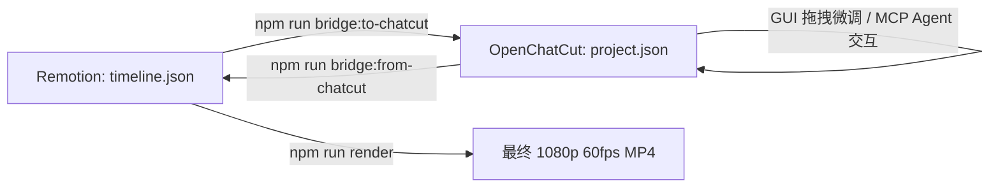

# OpenChatCut Editor & Bridge Skill (可视化多轨剪辑与 Agent MCP 控制)

## Overview
OpenChatCut 是基于 Remotion 底层渲染架构构建的轻量级、开源可视化多轨剪辑台。
在 `ai-video-studio` 流水线中，OpenChatCut 作为**交互式可视化剪辑前端**与 **Agent 对话式剪辑执行器**，通过双向 Bridge 脚本与核心总装引擎 `timeline.json` 实现无缝互通。

---

## 1. 架构定位与双向桥接工作流



### 1.1 导出到 OpenChatCut
当底层生成好分镜、配音与 SenseVoice 对齐后，执行：
```bash
npm run bridge:to-chatcut
# 或指定路径：
node scripts/bridge/timeline_to_chatcut.js inputs/timeline.json projects_chatcut/default_project/project.json
```
- **转换机制**：将 Remotion 的顺序分镜数组展开为 OpenChatCut 的 5 大标准化平行轨道：
  - `voiceover`：主配音轨（含词级对齐元数据）；
  - `video`：A-Roll 主画面 / 实拍出镜轨；
  - `broll`：HyperFrames MP4 或 AI 视频画中画轨；
  - `subtitles`：动态字幕轨；
  - `bgm`：背景音乐轨（预设自动闪避）。

### 1.2 从 OpenChatCut 同步回 Remotion
在 OpenChatCut 完成手动剪辑或 Agent MCP 修剪后，执行：
```bash
npm run bridge:from-chatcut
# 或指定路径：
node scripts/bridge/chatcut_to_timeline.js projects_chatcut/default_project/project.json inputs/timeline.json
```
- **核心保障**：
  - **自动吸附（Sanitizer）**：自动消除 $\le 3$ 帧的微小黑帧裂缝；
  - **时间戳平移**：若前半段被裁剪，后续所有词级高亮时间戳自动向前位移，保证字幕不串位。

---

## 2. OpenChatCut MCP 自动化协议 (Port 5199)

OpenChatCut 提供本地标准 MCP (Model Context Protocol) 接口，默认监听 `http://localhost:5199/mcp`。
Agent 可以调用以下标准化动作：

| MCP 工具 / Action | 参数示例 | 说明 |
| :--- | :--- | :--- |
| `split_clip` | `{ track: "voiceover", time_seconds: 12.5 }` | 在指定时间切断素材 |
| `delete_range` | `{ start_seconds: 8.0, end_seconds: 11.2 }` | 删除多余停顿并自动波纹合并（Ripple Delete） |
| `replace_asset` | `{ clip_id: "broll_scene_2", new_src: "public/footage/hf_flow.mp4" }` | 替换指定分镜的 B-Roll 视频 |
| `adjust_ducking` | `{ bgm_track_id: "bgm_1", ducking_db: -12.0 }` | 调整人声说话时的 BGM 压低分贝 |

---

## 3. 防坑规则与质量守护法则

1. **先做快照，再做剪辑（Mandatory Snapshot）**：
   在下发任何 Agent 批量修剪指令前，**必须**先创建版本快照：
   ```bash
   npm run snapshot:create -- --label "pre-chatcut-edit"
   ```
2. **防黑帧容错机制**：
   严禁用肉眼手动对齐片段尾部。始终依赖 `scripts/bridge/timeline_sanitizer.js` 的自动吸附与填充校验，确保总时长与配音轨绝对等长。
3. **音频平滑交叉淡化（Crossfade）**：
   切断配音或音效素材时，两端必须保留 20~30ms 的微小淡入淡出（Micro-Fade），杜绝音频切片在非零交叉点造成的破音（Pop/Click）。
