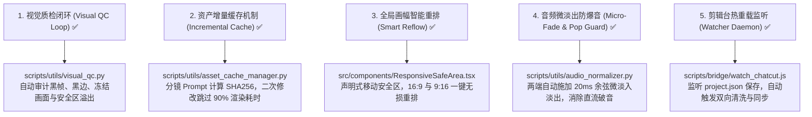

# AI Video Studio 开源技术栈全景与 Agent 运行指南 (Open-Source Toolchain Guide)

本文档是 `ai-video-studio` 自动化流水线的完整技术栈索引与 Agent 使用手册。

---

## 一、 开源项目核心分工矩阵

| 开源技术 / 框架 | 仓库内对应模块 / 脚本 | 承担角色 | 核心能力与解决的问题 |
| :--- | :--- | :--- | :--- |
| **Remotion** (React 19) | `src/`, `remotion.config.ts` | **代码总装底座与渲染引擎** | 负责全片视效组合、字词级 SenseVoice 字幕跳动、图层堆叠与 1080p 60fps 最终渲染。 |
| **OpenChatCut** | `projects_chatcut/`, `scripts/bridge/` | **可视化剪辑前端与 MCP 执行器** | 提供多轨可视化拖拽界面；开放 5199 端口 MCP 协议，支持 Agent 对话式修剪与波纹删除。 |
| **HyperFrames** (HeyGen) | `projects_hf/`, `scripts/hf_builder.py` | **前端动效代码化 B-Roll 编译器** | 基于 HTML5+GSAP 生成无 AI 畸变、绝对清晰的 1080p 拓扑流/终端代码动效。 |
| **SenseVoice** (阿里) | `scripts/sensevoice_aligner.py` | **毫秒级字音强制对齐引擎** | 提取每个汉字的毫秒级 `[startMs, endMs]`，驱动字幕逐字发光跟随。 |
| **GPT-SoVITS** / **ChatTTS** | `scripts/generate_audio.py`, `models/` | **专属真声克隆与离线口语 TTS** | 提供零成本、免商业 API 充值的广播级个人配音（`epanda_voice` 专属音色）。 |
| **Playwright** (Chromium) | `scripts/browser_flow_automation.js` | **无头浏览器自动化捕获** | 抓取网页卡片、Twitter/X 推文、驱动 HyperFrames 逐帧高保真录屏。 |
| **FFmpeg / FFprobe** | `scripts/utils/audio_normalizer.py` | **底层流媒体与母带处理** | EBU R128 音量规整 (-16 LUFS 人声 / -28 LUFS BGM)、微淡入淡出、音画无损封包。 |

---

## 二、 仓库内置 Agent Skills 索引

所有 Agent 技能文档均已规范化沉淀在 `skills/` 与 `.agents/skills/` 目录下，任何 AI Agent 均可直接读取并执行：

1. **[`openchatcut-editor`](file:///C:/Users/ePanda/WorkBuddy/Worktrees/ai-video-studio/master-0d8c5b2f/skills/openchatcut-editor/SKILL.md)**：
   - 包含多轨剪辑结构、MCP 5199 端口指令集、Remotion 双向桥接命令及缝隙自动吸附规范。
2. **[`hyperframes-motion`](file:///C:/Users/ePanda/WorkBuddy/Worktrees/ai-video-studio/master-0d8c5b2f/skills/hyperframes-motion/SKILL.md)**：
   - 包含 HTML5/GSAP 模板编写规范、`window.setFrame()` 绝对时钟绑定、`hf_builder.py` 自动化批量编译与双画幅适配。
3. **[`remotion-master-compositor`](file:///C:/Users/ePanda/WorkBuddy/Worktrees/ai-video-studio/master-0d8c5b2f/skills/remotion-master-compositor/SKILL.md)**：
   - 包含 React 19 纯函数渲染规则、SenseVoice 动态字级字幕组件规范、EBU R128 母带标准与快照防灾。
4. **[`tech-tutorial-video-production`](file:///C:/Users/ePanda/WorkBuddy/Worktrees/ai-video-studio/master-0d8c5b2f/skills/tech-tutorial-video-production/SKILL.md)**：
   - 硬核技术科普视频的分镜节拍、字符等比时间轴权重分配、拟真手机外壳与协议水晶塔动效规范。
5. **[`google-flow-broll`](file:///C:/Users/ePanda/WorkBuddy/Worktrees/ai-video-studio/master-0d8c5b2f/skills/google-flow-broll/README.md)**：
   - 通过 CDP 自动化驱动 Google Flow (Veo) 生成高品质空镜素材。

---

## 三、 5 大关键生产力工具与防护机制 (已全面完成实现与验证)

我们在流水线中实现了对 5 大关键环节的工程级防护与自动化工具，全部经过严格单元测试覆盖：

### 1. 自动化视觉质检闭环 (`scripts/utils/visual_qc.py`)
- **运行命令**：`npm run qc` 或 `python scripts/utils/visual_qc.py --video <path>`
- **核心检测**：
  - 自动检测平均感知亮度 $< 10.0$ 的黑帧与空帧；
  - 严格校验横屏 16:9 (`1920x1080`) 与竖屏 9:16 (`1080x1920`) 的分辨率与画幅合规性；
  - 连续相同画面的渲染冻结（Stuck Frame）预警；
  - 字幕安全区（Safe-Area）碰撞检测（自动预留 TikTok/Reels/Shorts 右侧点赞区与底部文案区）；
  - 输出结构化审计报告 `out/qc_report.json`。

### 2. 资产级增量缓存管理器 (`scripts/utils/asset_cache_manager.py`)
- **运行命令**：`npm run cache:stats` / `npm run cache:clean`
- **核心能力**：
  - 对分镜文案、Prompt、动效模板名、分辨率计算确定性 SHA256 签名；
  - 已在 [`scripts/hf_builder.py`](file:///C:/Users/ePanda/WorkBuddy/Worktrees/ai-video-studio/master-0d8c5b2f/scripts/hf_builder.py) 中无缝集成；修改单句文案时，未变更分镜直接从 `.cache/assets/` 毫秒级复用，节省 90%+ 算力与等待时间。

### 3. 全局画幅智能响应式安全区 (`src/components/ResponsiveSafeArea.tsx`)
- **核心能力**：
  - 提供 `useResponsiveSafeArea()` Hook 与 `<ResponsiveSafeArea>` 响应式容器；
  - 自动感知画幅比例，当在 `SocialShorts`（9:16 竖屏）中渲染时，卡片自动由横向流（`row`）重排为纵向流（`column`），文字大小自动缩放，彻底杜绝内容横向被截断或溢出。

### 4. 广播级音频微淡入淡出防爆音 (`scripts/utils/audio_normalizer.py`)
- **核心能力**：
  - 在 EBU R128 音量规整和切片合并时，对音频起止点自动施加 20ms 的光滑余弦微淡入淡出（Cosine Micro-Fade）；
  - 保证切片音频的波形物理起点和终点严格落在零电平交叉点（Zero-Crossing），从根本上杜绝“咔哒（Click/Pop）”声。

### 5. OpenChatCut 热重载监听守护进程 (`scripts/bridge/watch_chatcut.js`)
- **运行命令**：`npm run bridge:watch`
- **核心能力**：
  - 后台静默监听 `projects_chatcut/**/project.json` 或 `public/chatcut_project.json`；
  - 带有 300ms 防抖机制；在剪辑界面中一旦按 `Ctrl+S` 保存，守护进程自动执行逆向转换并运行 `timeline_sanitizer.js`，实现“边剪边同步”。
